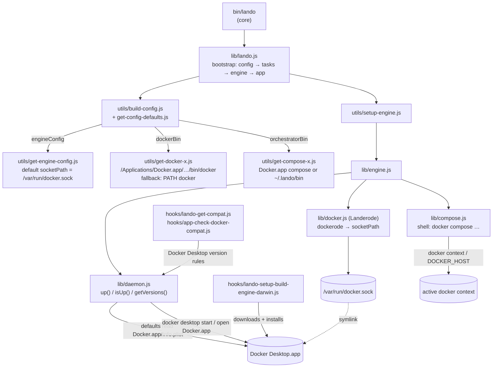
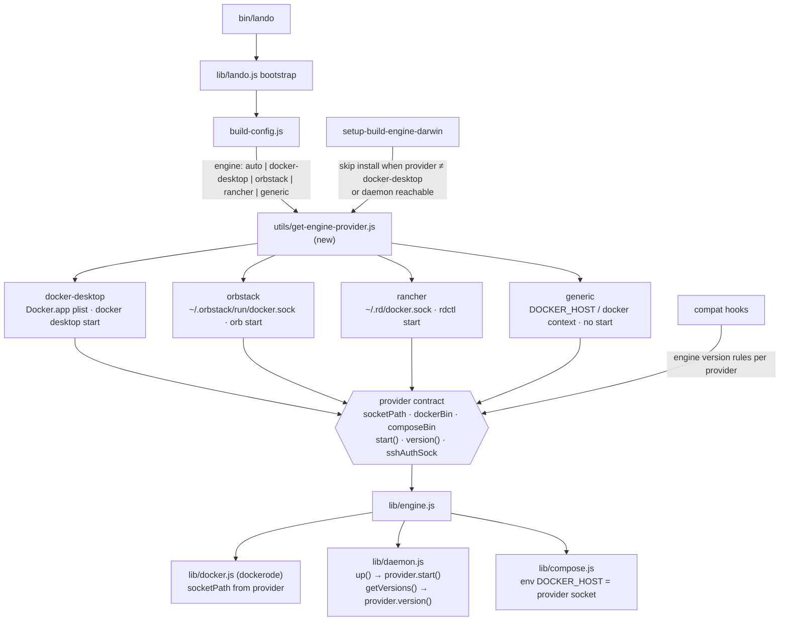

# Lando architecture — pluggable container engine

This document maps how Lando talks to its container engine today and the
intended architecture that lets it run on OrbStack or Rancher Desktop instead
of Docker Desktop.

- **Scope:** Lando 3 (`@lando/core` 3.26.x) on macOS, Apple Silicon first.
- **Tracking:** OSSC Jira — see [docs/engine/plan.md](docs/engine/plan.md).
- **Upstream issues:** [lando/lando#3388](https://github.com/lando/lando/issues/3388),
  [lando/core#138](https://github.com/lando/core/issues/138),
  [lando/core#53](https://github.com/lando/core/issues/53).
- **Due diligence:** [docs/engine/due-diligence.md](docs/engine/due-diligence.md).

## Repository layout

`lando/lando` is a meta-repo. It holds no runtime code — every component is a
git submodule under `lando/*`.

| Path | Submodule | Role |
|---|---|---|
| `core/` | `lando/core` | The CLI and runtime. **All engine code lives here.** |
| `core-next/` | `lando/core-next` | Lando 4 prototype (not used by the v3 CLI). |
| `plugins/*` | `lando/<name>` | Recipes and services (php, mysql, drupal, …). Engine-agnostic. |
| `setup-lando/` | `lando/setup-lando` | Install script and GitHub Action. |
| `website/`, `blog/`, `events/` | `lando/*` | Marketing and community sites. |

Engine work therefore happens on a fork of `lando/core`
(`jordan8037310/core`). This repo carries the planning docs and agent setup.

## Current architecture

### Where Docker Desktop is hardcoded

| # | Location | Coupling | Effect on OrbStack / Rancher |
|---|---|---|---|
| C1 | `lib/daemon.js` `getMacProp` / `getVersions()` | Reads `/Applications/Docker.app/Contents/Info.plist` | Returns `null` without Docker.app; `semver` then throws `Cannot read properties of null (reading 'trim')` (core#138). |
| C2 | `lib/daemon.js` `up()` | `docker desktop start` or `open /Applications/Docker.app` | Cannot auto-start another engine. |
| C3 | `hooks/lando-setup-build-engine-darwin.js` | `hasRun` = Docker.app exists | `lando setup` installs Docker Desktop unless `setup.buildEngine: false`. |
| C4 | `utils/get-docker-bin-path.js`, `get-docker-x.js`, `get-compose-x.js` | Docker.app `Contents/Resources/bin` | Falls back to `PATH`; mostly works. |
| C5 | `utils/get-engine-config.js` | Default `socketPath: /var/run/docker.sock`; ignores `DOCKER_HOST` and docker contexts | **Split brain:** dockerode talks to the socket while the `docker`/`docker compose` CLIs follow the active context. Two engines installed can mean two engines in use. |
| C6 | `hooks/app-check-docker-compat.js`, `get-config-defaults.js` `getBuildEngineVersion` | Docker Desktop version ranges (4.85.0) | Spurious "unsupported / update Docker Desktop" warnings. |
| C7 | `packages/ssh-agent/ssh-agent.js` | `/run/host-services/ssh-auth.sock` (Docker Desktop VM path) | OrbStack provides it; Rancher does not. |
| C8 | `index.js` `LANDO_HOST_UID/GID` | Assumes Docker Desktop's file-ownership translation | Ownership edge cases on OrbStack and Colima (core#53). |

The `/Applications/Docker.app` coupling is so strong that the published
OrbStack guide (`core/docs/guides/how-do-i-use-orbstack.md`) tells users to
`sudo ln -s /Applications/OrbStack.app /Applications/Docker.app`.

## Intended architecture

One new seam: an **engine provider**, resolved once from config, that answers
the five questions core currently answers with Docker Desktop paths.

### Design rules

- **One socket for every client.** The provider's `socketPath` feeds dockerode
  *and* is exported as `DOCKER_HOST=unix://…` for the `docker` and
  `docker compose` subprocesses. This closes the C5 split brain.
- **`auto` keeps today's behavior.** With no `engine` key, Docker Desktop
  users see no change; detection order is Docker.app → OrbStack → Rancher →
  `DOCKER_HOST`.
- **Config before code.** `engineConfig.socketPath` and `setup.buildEngine:
  false` already exist; the provider generalises them rather than replacing
  them.
- **Version checks are per provider.** A provider with no known version range
  returns `skip`, the convention `getVersions()` already uses on Windows.
- **No Lando 4 dependency.** This is a v3 change, small enough to upstream.

### Minimum change set (v3)

1. `utils/get-engine-provider.js` — provider table and `auto` detection.
2. `lib/daemon.js` — `up()` and `getVersions()` delegate to the provider; a
   missing plist yields `skip`, never `null` (fixes core#138).
3. `utils/get-engine-config.js` — honour `DOCKER_HOST` (`unix://`) and export
   it to subprocesses.
4. `hooks/lando-setup-build-engine-darwin.js` — skip when the provider is not
   Docker Desktop or the daemon is reachable.
5. `hooks/app-check-docker-compat.js` — no Docker Desktop warnings on other
   providers.
6. Unit specs for each, in `core/test/` (mocha + chai, see [TOOLS.md](TOOLS.md)).

## Documentation map

| Doc | Purpose |
|---|---|
| [CLAUDE.md](CLAUDE.md) | How agents contribute; points here. |
| [TOOLS.md](TOOLS.md) | Test suites, lint, toolchain. |
| [docs/engine/due-diligence.md](docs/engine/due-diligence.md) | OrbStack vs Rancher: performance, risk, incompatibilities. |
| [docs/engine/plan.md](docs/engine/plan.md) | Phased plan, OSSC tickets, user-doc pages to update. |
| `core/docs/` | User docs published at docs.lando.dev (upstream-owned). |
